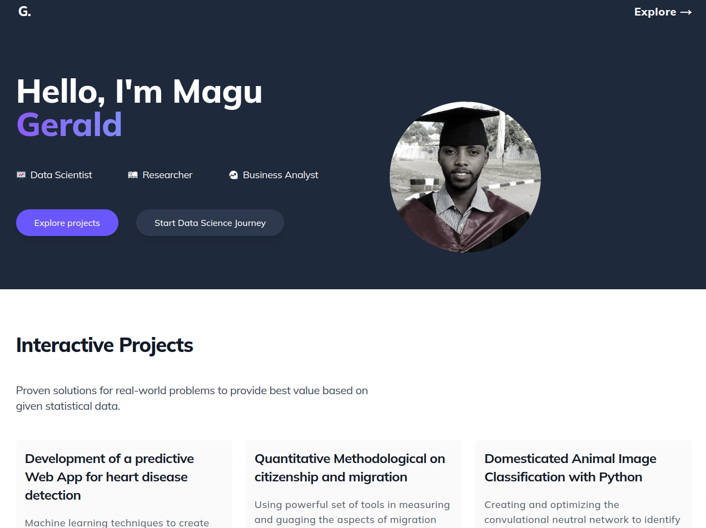

## Gerald Magu Personal Portfolio

A portfolio showcasing the Data Science and Machine Learning contributions of Magu Gerald.

## Features

- Mobile responsive
- Live previews
- Fullscreen mode
- Fullstack Server-side rendering

## Tech Stack

**Client:** React, TailwindCSS

**Server:** Nextjs 13, Express, Node

## Portfolio Demo

https://www.magugerald.com/

## Deploy to Vercel

The app uses Prisma with PostgreSQL. Create a PostgreSQL database (for example, through Neon), then import this GitHub repository into Vercel as a Next.js project.

Set these Vercel environment variables for the Production environment and for Preview deployments (use a separate database/branch for previews):

- `DATABASE_URL`: the pooled PostgreSQL connection string
- `DIRECT_URL`: the direct, non-pooled PostgreSQL connection string
- `JWT_SECRET_KEY`: a random secret at least 32 bytes long
- `JWT_EXPIRES_IN`: token lifetime in minutes (for example, `60`)

Vercel uses `npm run vercel-build`, which applies checked-in Prisma migrations before building. The initial production database will be empty; SQLite data from `prisma/dev.db` is not migrated. `npm install` generates the Prisma client through the existing `postinstall` script.

For local development, create a PostgreSQL database and copy `.env.example` to `.env.local`, replacing the placeholder connection strings and secret. Then run `npx prisma migrate deploy` and `npm run dev`.

Do not commit `.env` files. A previously committed `.env` may remain in Git history, so rotate any credentials that were in it before deploying.

## Lessons Learned

Nextjs 13 makes the development journey seamless and has advanced features such as adopting **React server components** functionalities.

## Support

For support, email magugerald@gmail.com or reach me through Twitter.

## Developer

- Github - [@kenmwangi](https://www.github.com/kenmwangi)
- Twitter - [@ken_cipher](https://www.twitter.com/ken_cipher)

## License

[MIT](https://choosealicense.com/licenses/mit/)

## Acknowledgements

- [Nextjs Documentation](https://nextjs.org/docs)
- [Tailwindcss](https://tailwindcss.com/)
